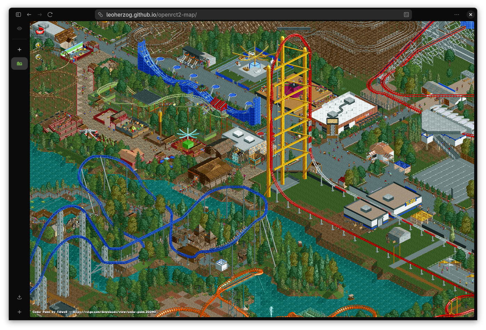

# OpenRCT2 Map Generator

[](#)
[](#)
[](#)

Generate a zoomable, pannable Leaflet map from any OpenRCT2 park save, like [Dynmap](https://github.com/webbukkit/dynmap) or [Unmined](https://unmined.net/) for Minecraft.

[](https://leoherzog.github.io/openrct2-map/)
*See [leoherzog.github.io/openrct2-map](https://leoherzog.github.io/openrct2-map/) for an example render. Thanks to fidwell for the awesome [Cedar Point re-creation](https://rctgo.com/downloads/view/cedar-point.22290) and Mulpje for the astounding [Tranquility Park](https://rctgo.com/downloads/view/tranquility-park.19354)!*

## Requirements

| Requirement | Notes |
|---|---|
| **OpenRCT2** | Auto-downloaded on Linux x86_64 and Windows |
| **[RCT2 game assets](https://archive.org/details/OpenRCT2Assets)** | Auto-downloaded on Linux, which needs `unzip` |
| **RCT1 game assets** | Only for parks with RCT1 objects or scenarios |
| **Node.js 24+** | Run `npm install` once |

The tool looks for OpenRCT2 in the current directory and in standard install locations. If it finds none on Linux x86_64 or Windows, it downloads the latest portable release to the current directory and keeps it up to date. An `openrct2` found only on your `PATH` does not count, so pass `--openrct2 openrct2` to use it.

On Linux, the tool looks for game data in `./assets/RCT/`, then at `game_path` and `rct1_path` in OpenRCT2's own `config.ini`, then in Steam. Missing RCT2 data is downloaded to `./assets/RCT/`. On Windows and macOS, OpenRCT2 reads only its own `config.ini`, so run it once and point it at your game.

## Usage

> [!IMPORTANT]
> Unchanged tiles are symbolic links into earlier snapshots, so **deleting a snapshot directory by hand breaks them**. Use `--remove` or `--clear` instead. On Windows, without **Administrator privileges** or [**Developer Mode**](https://learn.microsoft.com/en-us/windows/apps/get-started/enable-your-device-for-development), unchanged tiles are copied, not linked.
>
> Never run two renders into the same output directory at once, or they delete each other's unfinished files.

```sh
# Render a park and serve the result
node main.ts MyPark.park -o ./output
uv run python3 -m http.server -d ./output

# Add a snapshot, skipped while the save file is unchanged, even with new flags
node main.ts MyPark.park -o ./output --label "Week 2"

# Snapshot even if the map is unchanged
node main.ts MyPark.park -o ./output --force

# Override screenshot flags (cloudy weather, no guests)
node main.ts MyPark.park -o ./output -- --weather=3 --no-peeps

# List, rename and remove snapshots
node main.ts --list -o ./output
node main.ts --rename 20260312-143022 --label "New label" -o ./output
node main.ts --remove 20260312-143022 -o ./output

# Start fresh, as needed to change --rotations or --tile-size
node main.ts MyPark.park -o ./output --clear
```

`--domain` and `--status` are not saved, so pass them to every render, `--rename` and `--remove`. `--status` sees only servers with `advertise = true` in their config, and shows others as Offline.

In the viewer, `R` rotates the map and `←`/`→` step through snapshots. The address bar holds the view for sharing, though `--remove` can shift which snapshot a link shows.

## `node main.ts --help`

```sh
$ node main.ts --help
Usage: node main.ts <savefile> [options] [-- openrct2-flags...]

Options:
  -o, --output <dir>       Output directory (default: ./output)
  --zoom <n>               Finest OpenRCT2 zoom level, 0 = closest (default: 1)
                           Renders at zoom n through 3 for native sprites at each level
  --rotations <list>       Comma-separated rotations 0-3 to render (default: 0,1,2,3)
  --openrct2 <path>        Path to openrct2 binary/AppImage (default: auto-detect)
  --rct2-data-path <path>  Path to RCT2 data dir (containing Data/g1.dat) [Linux only, auto-detected]
  --rct1-data-path <path>  Path to RCT1 data dir (containing Data/csg1.dat) [Linux only, auto-detected]
  --label <text>           Label for this snapshot (default: current date/time)
  --list                   List all snapshots in the output directory
  --rename <timestamp>     Rename a snapshot label (use with --label)
  --remove <timestamp>     Remove a snapshot by its timestamp key
  --clear                  Clear all existing snapshots before generating
  --force                  Save snapshot even if map is unchanged from last run
  --tile-size <n>          Tile size in pixels (default: 256)
  --compression <0-9>      PNG compression level (default: 6, 0 = fastest)
  --effort <1-10>          Palette quantization effort (default: 7, implies --palette)
                           Below 4 is faster but lossy
  --palette                Use indexed-color PNG (smaller files for pixel art)
  --skip-blanks <n>        Skip tiles within n of transparent (default: 0)
                           Use --skip-blanks=-1 to keep every tile
  --concurrency <n>        Sharp/libvips thread count (default: CPU cores)
  --single-zoom            Only render at the specified zoom level (skip native zoom pyramid)
  --domain <url>           Base URL for OG tags (e.g. https://example.com/map)
  --status <name>          Show live online/offline status of this advertised server
  -h, --help               Show this help

Auto-download: without --openrct2, a render that finds no OpenRCT2, or finds a
  portable copy in the current directory, downloads the latest release there if
  missing (Linux x86_64, Windows). An install in a standard path is never replaced.
  On Linux, RCT2 assets are downloaded to ./assets/RCT unless found or
  --rct2-data-path is set. Elsewhere OpenRCT2 uses game_path from its own config.ini.

Screenshot defaults (applied unless you override that specific flag after --):
  --transparent, --tidy-up-park, --weather=1

Extra flags after -- are forwarded to openrct2 screenshot, e.g.:
  node main.ts park.park -o out -- --no-peeps
  node main.ts park.park -o out -- --weather=3  (overrides default sunny)

OpenRCT2 screenshot flags (pass after --):
    --weather=<int>           weather to be used (0 = default, 1 = sunny, ..., 6 = thunder).
    --no-peeps                hide peeps
    --no-sprites              hide all sprites (e.g. balloons, vehicles, guests)
    --clear-grass             set all grass to be clear of weeds
    --mowed-grass             set all grass to be mowed
    --water-plants            water plants for the screenshot
    --fix-vandalism           fix vandalism for the screenshot
    --remove-litter           remove litter for the screenshot
    --tidy-up-park            clear grass, water plants, fix vandalism and remove litter
    --transparent             make the background transparent
    --draw-bounding-boxes     draw bounding boxes
    --draw-segment-heights    draw segment heights
```

### License

Feel free to take a look at the source and adapt as you please.

[](http://creativecommons.org/licenses/by-sa/4.0/)

openrct2-map is licensed under a [Creative Commons Attribution-ShareAlike 4.0 International License](http://creativecommons.org/licenses/by-sa/4.0/).

### Thanks

This project wouldn't be possible without:
- [OpenRCT2](https://openrct2.io/) — the open-source re-implementation of RollerCoaster Tycoon 2
- [Chris Sawyer](https://www.chrissawyergames.com/) — legendary creator of the original RollerCoaster Tycoon
- [The Spriters Resource](https://www.spriters-resource.com/pc_computer/rollercoastertycoon2/asset/135826/) — extracted RCT2 sprite assets
- [RCT2 Font](https://fontstruct.com/fontstructions/show/465125/rct2) — recreation of the RollerCoaster Tycoon 2 bitmap typeface
- [Sharp](https://sharp.pixelplumbing.com/) — high-performance image processing (powered by [libvips](https://www.libvips.org/))
- [Leaflet](https://leafletjs.com/) — interactive map library
- [Font Awesome](https://fontawesome.com/) — favicon

---

#### About Me

<a href="https://herzog.tech/" target="_blank">
  <picture>
    <source media="(prefers-color-scheme: dark)" srcset="https://herzog.tech/signature/link-light.svg.png">
    <source media="(prefers-color-scheme: light)" srcset="https://herzog.tech/signature/link.svg.png">
    
  </picture>
</a>
<a href="https://mastodon.social/@herzog" target="_blank">
  <picture>
    <source media="(prefers-color-scheme: dark)" srcset="https://herzog.tech/signature/mastodon-light.svg.png">
    <source media="(prefers-color-scheme: light)" srcset="https://herzog.tech/signature/mastodon.svg.png">
    
  </picture>
</a>
<a href="https://github.com/leoherzog" target="_blank">
  <picture>
    <source media="(prefers-color-scheme: dark)" srcset="https://herzog.tech/signature/github-light.svg.png">
    <source media="(prefers-color-scheme: light)" srcset="https://herzog.tech/signature/github.svg.png">
    
  </picture>
</a>
<a href="https://keybase.io/leoherzog" target="_blank">
  <picture>
    <source media="(prefers-color-scheme: dark)" srcset="https://herzog.tech/signature/keybase-light.svg.png">
    <source media="(prefers-color-scheme: light)" srcset="https://herzog.tech/signature/keybase.svg.png">
    
  </picture>
</a>
<a href="https://www.linkedin.com/in/leoherzog" target="_blank">
  <picture>
    <source media="(prefers-color-scheme: dark)" srcset="https://herzog.tech/signature/linkedin-light.svg.png">
    <source media="(prefers-color-scheme: light)" srcset="https://herzog.tech/signature/linkedin.svg.png">
    
  </picture>
</a>
<a href="https://hope.edu/directory/people/herzog-leo/" target="_blank">
  <picture>
    <source media="(prefers-color-scheme: dark)" srcset="https://herzog.tech/signature/anchor-light.svg.png">
    <source media="(prefers-color-scheme: light)" srcset="https://herzog.tech/signature/anchor.svg.png">
    
  </picture>
</a>
<br />
<a href="https://herzog.tech/$" target="_blank">
  <picture>
    <source media="(prefers-color-scheme: dark)" srcset="https://herzog.tech/signature/mug-tea-saucer-solid-light.svg.png">
    <source media="(prefers-color-scheme: light)" srcset="https://herzog.tech/signature/mug-tea-saucer-solid.svg.png">
    
  </picture>
  Found this helpful? Buy me a tea!
</a>
